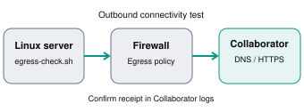

# Egress Check

A lightweight Bash utility for assessing outbound network connectivity and egress filtering on Linux hosts during authorized security assessments. It supports DNS (UDP/53), ICMP, TCP (including ports 80 and 443), and HTTPS connectivity checks using `curl` or `wget`. Additionally, it supports Out-of-Band Application Security Testing (OAST) to validate outbound DNS and HTTPS communication with controlled external endpoints, such as Burp Collaborator.

**Scope:** This is a connectivity-testing utility, not a data-exfiltration tool or proof that an arbitrary destination is reachable. Only test systems and destinations you are authorized to assess.

## Features

- Raw UDP DNS A queries with a configurable IPv4 resolver and domain
- Optional short synthetic DNS marker, hex-encoded into the leftmost DNS label
- ICMP echo test (`ping`)
- TCP connection tests for configurable ports (defaults: 80 and 443)
- HTTPS request test with `curl` or `wget`
- Per-check timeout, timestamps, status output, and optional JSON evidence
- Optional display of the raw DNS query packet in hexadecimal

## Requirements

- Linux with Bash
- `python3` for DNS testing and JSON output
- `ping` for ICMP testing
- GNU `timeout` for TCP testing
- `curl` or `wget` for HTTPS testing

Missing `ping`, `timeout`, `curl`, or `wget` may cause the corresponding test to be marked `SKIP`. The DNS test uses Python's standard library; no third-party Python packages are needed.

## Installation

```bash
git clone https://github.com/kryptohaker/egress-check.git
cd egress-check
chmod +x egress-check.sh
./egress-check.sh --help
```

## Usage

Run all five checks (also the default when no test selector is specified):

```bash
./egress-check.sh --all
```

Test a specific DNS resolver and domain:

```bash
./egress-check.sh --dns 1.1.1.1 --domain example.com
```

Encode a harmless marker into a DNS query name:

```bash
./egress-check.sh --dns 1.1.1.1 --domain example.com --data egress-test --show-hex
```

Test ICMP and TCP ports:

```bash
./egress-check.sh --icmp --tcp 80,443 --host 1.1.1.1
```

Test HTTPS:

```bash
./egress-check.sh --https --url https://example.com
```

Run all checks with detailed timing and connection diagnostics:

```bash
./egress-check.sh --all --verbose
```

Write JSON evidence:

```bash
./egress-check.sh --all --output results.json
```

Use a different timeout:

```bash
./egress-check.sh --all --timeout 10
```

### Options

| Option | Description | Default |
| --- | --- | --- |
| `--all` | Run DNS, ICMP, TCP, and HTTPS checks | Automatically used if no check selected |
| `--dns [IP]` | Enable DNS check, optionally set resolver | `1.1.1.1` |
| `--domain DOMAIN` | Domain for DNS A query | `duckduckgo.com` |
| `--data TEXT` | Synthetic DNS marker (1–24 ASCII letters, digits, `_` or `-`) | None |
| `--show-hex` | Print raw DNS query packet as hex | Off |
| `--verbose`, `-v` | Show DNS response codes and timings, ping diagnostics, TCP errors, and HTTPS timings | Off |
| `--icmp` | Enable ICMP test | Off unless `--all` |
| `--tcp PORTS` | Enable TCP tests for comma-separated ports | `80,443` |
| `--https` | Enable HTTPS test | Off unless `--all` |
| `--host IP` | IPv4 destination for ICMP and TCP | `104.18.74.230` |
| `--url HTTPS_URL` | HTTPS request target | `https://1.1.1.1` |
| `--timeout SECONDS` | Per-test timeout, positive integer | `5` |
| `--output FILE.json` | Save structured JSON results | No file |
| `-h`, `--help` | Show help | — |

**Note:** `--domain`, `--data`, and `--show-hex` configure the DNS check; add `--dns` when you want to run only DNS. `--all` runs all checks even when other check selectors are present.

The command-line output always explains that `PASS` means the specific connectivity test succeeded, **not** that unrestricted egress or data exfiltration was demonstrated. Verbose diagnostics are printed to the terminal; JSON output retains the standard per-check results.

## Burp Collaborator / OAST verification

If you have an authorized Burp Collaborator hostname, use it as the DNS domain:

```bash
./egress-check.sh --dns 1.1.1.1 \
  --domain YOUR-ID.oastify.com \
  --data egress-test
```

The tool sends a DNS A query for `6567726573732d74657374.YOUR-ID.oastify.com`. Poll Collaborator separately to confirm the interaction. **The script does not access the Collaborator API or automatically verify callbacks.** A resolver response alone does not prove that the authoritative service received the query. The visible source IP in Collaborator may be the recursive resolver, not the host under test.

Use only synthetic test markers. Do not include secrets, credentials, or sensitive files in `--data`.

## OAST callback testing (`--oast`)

Use an authorized Burp Collaborator or other OAST hostname to initiate **one DNS query and one HTTPS request** with unique per-run identifiers:

```bash
./egress-check.sh --oast YOUR-ID.oastify.com --verbose --output oast-results.json
```

The script constructs `dns-<id>.YOUR-ID.oastify.com` for DNS and `https-<id>.YOUR-ID.oastify.com` for HTTPS, using the same random run ID. It queries the DNS name through the default resolver (`1.1.1.1`, configurable using `--dns`) and makes an HTTPS request to the second hostname. Check the Collaborator dashboard for both interactions and match the ID. **Local PASS does not prove the remote OAST service received the interaction**; DNS `NXDOMAIN` can also count as a valid resolver response. A local FAIL does not rule out a remote interaction either.

The script does not automatically poll Burp Collaborator, and does not send actual files, credentials, or other sensitive data. Only use OAST hostnames that you control or are authorized to test. `--oast` selects DNS and HTTPS only; add `--all` to also run the baseline ICMP and TCP tests.

**How Burp Collaborator improves the assessment**



For example, you could run:

```bash
./egress-check.sh \
  --dns 1.1.1.1 \
  --domain YOUR-ID.oastify.com \
  --data "egress-test" \
  --verbose
```

And:

```bash
./egress-check.sh \
  --https \
  --url https://YOUR-ID.oastify.com \
  --verbose
```

If Burp Collaborator records the interactions, you have evidence of outbound communication to your controlled destination.

## Understanding results

- `PASS`: The specific test succeeded. For DNS, a valid DNS response (including NXDOMAIN) establishes resolver reachability; it does not prove an authoritative callback.
- `FAIL`: The test failed or timed out. This does not by itself establish that a firewall blocked the traffic.
- `SKIP`: A required command for that test was unavailable.

A TCP `PASS` means a connection was established, **not** that HTTP or TLS was successfully negotiated. An HTTPS `PASS` means an HTTPS request completed, even if the HTTP status indicates an application error. HTTPS certificate verification is **disabled** (`curl -k` / `wget --no-check-certificate`) to match the original connectivity-testing behavior; do not use this as a TLS-security validation tool.

The script exits with code `1` if any check is marked `FAIL`; otherwise it exits with `0` after tests complete (including when some tests are `SKIP`). Invalid arguments and missing mandatory dependencies cause an early error.

### JSON output

The `--output` option writes a JSON object containing a `results` array. Each entry has `timestamp`, `check`, `destination`, `status`, and `detail` fields. For example:

```json
{
  "results": [
    {
      "timestamp": "2026-11-05T15:00:00Z",
      "check": "ICMP",
      "destination": "1.1.1.1",
      "status": "PASS",
      "detail": "Echo reply received"
    }
  ]
}
```

This is an illustrative example, not a captured test result.

## Assessment and reporting guidance

Record the host, test time, target, protocol, observed result, and any supporting firewall, proxy, DNS, or Collaborator logs. Distinguish:

1. **Network reachability** — e.g., TCP connection or ICMP echo reply.
2. **Application response** — e.g., DNS response or completed HTTPS request.
3. **Verified external callback** — e.g., an interaction observed at an authorized OAST endpoint.

Do not describe successful connectivity checks alone as confirmed data exfiltration or an exploitable vulnerability. Assess whether the observed egress violates the organization's intended network policy.

## Limitations

- IPv4 targets only for the DNS resolver and ICMP/TCP host.
- DNS uses a single UDP A query; it does not test DNS-over-TCP, DNS-over-HTTPS, tunneling, or bulk transfer.
- The script does not retry failed checks or detect proxies/firewall rules.
- Network policies may differ by destination, protocol, identity, or time.
- OAST interactions require manual confirmation in the relevant service.

## License

This project is licensed under the MIT License.
See the [LICENSE](LICENSE) file for details.

